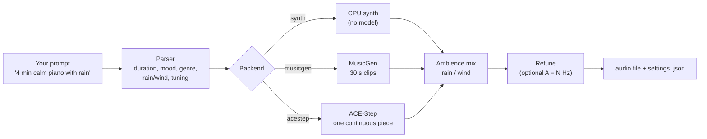

# aimusic


Describe music in plain English; get an audio file. Runs locally with open-source models.

```
aimusic "Create 4 min long soothing music with rain in the background, good for studying, theme: sitting on a forest floor"
```

The tool shows how it understood your request, asks for confirmation, generates
the music, mixes in rain or wind if you asked for it, and saves a `.wav`/`.mp3`
plus a `.json` file with every setting used.

> **Early-stage project (v0.1).** Two neural backends work: MusicGen (30 s
> clips) and ACE-Step (continuous tracks up to 5 minutes verified on a 4 GB
> GPU). Read [Limitations](#limitations) before relying on it.

**[▶ Listen in your browser (demo page)](https://himanshugupta2312.github.io/ai-music-generator/)** with
playable audio and copy-paste commands. Or jump straight to a file (GitHub shows a download or play
page for MP3s). Made with ACE-Step: [calm + rain, 2 min](examples/acestep-calm-study-rain-2min.mp3) ·
[punk rock](examples/acestep-punk-rock.mp3) · [lofi beats](examples/acestep-lofi-beats.mp3) ·
[cinematic](examples/acestep-cinematic.mp3) · [jazz](examples/acestep-jazz.mp3) ·
[hip hop + punk at 450 Hz](examples/acestep-hiphop-punk-450hz.mp3)
(all in [`examples/`](examples/); prompts and details in [Examples](#examples) below)

## Try it in 2 minutes

```
git clone https://github.com/himanshugupta2312/ai-music-generator
cd ai-music-generator
python -m venv .venv
.venv\Scripts\activate            # Windows (use source .venv/bin/activate on Linux/macOS)
pip install -e ".[dev]"
aimusic "30 sec calm piano with rain" -y
```

That uses the built-in `synth` backend: no GPU, no downloads, but basic sound.
For real AI-generated music, install the [ACE-Step or MusicGen backend](#install).

## Web UI

Prefer a window to the terminal? Install the optional UI and start it:

```
pip install -e ".[ui]"
aimusic ui
```

It opens in your browser at `http://127.0.0.1:7860` and only listens on your own
machine. You get:

- a prompt box with clickable example prompts;
- a live "How I read your request" panel (length, style, ambience, tuning) that
  updates as you type, before you generate anything;
- a backend choice (it picks ACE-Step, then MusicGen, then the CPU synth, based on what
  is installed) and advanced settings: length, seed, tuning, ambience, lyrics;
- a progress bar with elapsed time and a rough time estimate (the estimate comes from
  one 4 GB laptop GPU, so yours may differ), a built-in player, a download button, and
  the exact settings used;
- a **Stop** button. For ACE-Step it ends the generation process (tested: the process
  exits within about 2 seconds and no partial file is saved). MusicGen and the synth
  cannot be interrupted mid-run; they finish in the background.

One track is generated at a time. Files are saved in an `output/` folder next to where
you started it. The UI has been tested through its web API and with automated tests, but
I have not looked at it in a browser, so layout problems are possible.

## Examples

Just write what you want. The tool pulls out duration, tempo, mood, genre,
ambience and tuning, then shows you the result before generating.

**ACE-Step** (one continuous piece, 48 kHz stereo; add `--backend acestep`):

| You type | It understands | Listen |
|---|---|---|
| `aimusic "2 min calm soothing piano music with rain for studying" --seed 3` | 2 min, instrumental, calm piano, **rain layer mixed in** | [acestep-calm-study-rain-2min.mp3](examples/acestep-calm-study-rain-2min.mp3) |
| `aimusic "45 sec punk rock with distorted guitars and fast drums" --seed 5` | punk rock, distorted guitars, power chords | [acestep-punk-rock.mp3](examples/acestep-punk-rock.mp3) |
| `aimusic "45 sec lofi hip hop beats, mellow, 85 bpm" --seed 8` | lo-fi hip hop, boom bap drums, 808 bass, 85 bpm | [acestep-lofi-beats.mp3](examples/acestep-lofi-beats.mp3) |
| `aimusic "45 sec epic cinematic music" --seed 2` | cinematic, orchestral, epic, powerful drums | [acestep-cinematic.mp3](examples/acestep-cinematic.mp3) |
| `aimusic "45 sec mellow jazz with soft piano, 70 bpm" --seed 4` | jazz, soft piano, brushed drums, 70 bpm | [acestep-jazz.mp3](examples/acestep-jazz.mp3) |
| `aimusic "45 sec soundtrack with hip hop beats and punk music at 450hz" --seed 11` | hip hop + punk, **tuned to A = 450 Hz** (pitch-shifted afterwards) | [acestep-hiphop-punk-450hz.mp3](examples/acestep-hiphop-punk-450hz.mp3) |

<details>
<summary><strong>MusicGen examples</strong> (20 s clips, 32 kHz mono; add <code>--backend musicgen</code>)</summary>

| You type | It understands | Listen |
|---|---|---|
| `aimusic "20 sec calm soothing piano music with rain for studying" --seed 3` | 20 s, calm piano, rain layer | [calm-study-rain.mp3](examples/calm-study-rain.mp3) |
| `aimusic "20 sec punk rock with distorted guitars and fast drums" --seed 5` | 20 s, punk rock | [punk-rock.mp3](examples/punk-rock.mp3) |
| `aimusic "20 sec lofi hip hop beats, mellow, 85 bpm" --seed 8` | 20 s, lo-fi hip hop, 85 bpm | [lofi-beats.mp3](examples/lofi-beats.mp3) |

</details>

Each example has a `.json` next to it in [`examples/`](examples/) with the exact
settings and seed, so you can reproduce it.

> **About these samples:** they are the first output for each prompt, **not
> hand-picked**. The author listened to them and rated the quality as okay but
> not high: expect rough edges and see [Limitations](#limitations) for why.
> They are demonstrations only. MusicGen's model weights are non-commercial
> (CC-BY-NC); ACE-Step's code is MIT-licensed, but check its model terms before
> any commercial use. The 450 Hz example is 44 s because the retune shortens the
> audio by about 2%.

## Prompt cookbook

Copy a line (GitHub shows a copy button on each code block), paste it, and change the words.

| I want... | Try this |
|---|---|
| Background music for studying | `aimusic "4 min soothing piano and ambient music for studying" --backend acestep -y` |
| ...with rain | `aimusic "2 min calm piano with rain for studying" --backend acestep -y` |
| A steady beat at a set tempo | `aimusic "1 min lofi hip hop beats, 85 bpm" --backend acestep -y` |
| High energy | `aimusic "45 sec punk rock with distorted guitars and fast drums" --backend acestep -y` |
| A film-style feel | `aimusic "45 sec epic cinematic music" --backend acestep -y` |
| A different tuning | `aimusic "soundtrack with hip hop beats and punk at 450hz" --backend acestep -y` |
| The same result again | add `--seed 42` (use the same seed and the same prompt) |
| A different take | change `--seed` (any number) |
| MP3 instead of WAV | add `--out song.mp3` (needs ffmpeg) |
| A window instead of the terminal | `aimusic ui` (see [Web UI](#web-ui)) |
| To check my setup | `aimusic doctor` |

<details>
<summary><strong>More ideas and which words the tool recognises</strong></summary>

```
aimusic "sleep music with wind, 1 hour"                    # wind layer (1 hour is over the 10-minute cap, so use 10 min)
aimusic "epic cinematic trailer" --lyrics words.txt        # your own lyrics (backend support varies; not tested)
aimusic "rainy night jazz" --llm llama3.2                  # let a local Ollama model write the style prompt (untested)
```

Recognised keywords include: calm, soothing, relax, sleep, study, focus, lofi,
forest, cinematic, epic, dark, happy, sad, jazz, piano, guitar, acoustic, punk,
hip hop, trap; plus rain and wind ambience. Anything else is passed through
as plain text, which the model may or may not understand.

Tips: say the length ("45 sec", "2 min", up to 10 min), the genre, and one or two
instruments. The tool shows how it read your prompt before generating, so check
that list and rephrase if something is missing.

</details>

## How it works



- **Parser** (rule-based): extracts duration ("4 min"), tempo ("120 bpm"), mood
  and genre keywords, rain/wind, instrumental vs vocals, and tuning ("450hz").
  Optionally a local Ollama model can rewrite the style description (`--llm`).
- **Backends** (swappable): `synth` (CPU, no model), `musicgen` (30 s clips),
  `acestep` (one continuous generation of minutes; runs in its own environment).
- **Ambience:** rain and wind are synthesized procedurally, so no sample licensing applies.
- **Tuning:** `--tuning 450` shifts finished audio so concert A sits at 450 Hz.

## Install

Requires Python 3.10+ (3.11/3.12 recommended).

```
python -m venv .venv
.venv\Scripts\activate          # Windows
pip install -e ".[dev]"         # core + tests (synth backend only)
```

For the MusicGen backend, install the CUDA build of PyTorch first. A plain
`pip install torch` on Windows gives the CPU-only build:

```
pip install torch torchaudio --index-url https://download.pytorch.org/whl/cu126
pip install -e ".[musicgen]"
aimusic "lofi study beats" --backend musicgen -y
```

MP3 export needs `ffmpeg` on PATH. Run `aimusic doctor` to check your setup.
Model weights (about 2 GB for MusicGen-small) download from Hugging Face on first use.

### ACE-Step backend (continuous tracks, minutes long)

ACE-Step pins its own PyTorch (2.7.1+cu128 on Windows), which conflicts with the
MusicGen setup, so it is installed separately and `aimusic` runs it as a subprocess.

```
git clone https://github.com/ace-step/ACE-Step-1.5
cd ACE-Step-1.5
pip install uv
uv sync                          # several GB; needs Python 3.11 or 3.12
```

Keep the `ACE-Step-1.5` folder next to this repo, or set `ACESTEP_HOME` to its path.
Then:

```
aimusic "4 min soothing piano and ambient music for studying" --backend acestep -y
```

Model weights (about 7 GB) download on the first run. ACE-Step is MIT licensed.
Low-memory mode is used automatically: no language model, INT8 weights and CPU offload
(ACE-Step's own recommendation for 6 GB or less). On GPUs older than Ampere (RTX 30
series), `aimusic` forces bfloat16, because the default float16 produced NaN errors
on the test GPU (see [Limitations](#limitations)).

<details>
<summary><strong>All command-line flags</strong></summary>

| Flag | Meaning |
|---|---|
| `--backend` | `synth` (default), `musicgen`, `acestep` |
| `--duration` | seconds; overrides the prompt (maximum 600) |
| `--seed` | reproducible results |
| `--tuning HZ` | concert A in Hz (default 440), applied after generation |
| `--lyrics FILE` | lyrics with `[verse]` / `[chorus]` tags |
| `--no-soundscape`, `--ambience-level` | control the rain/wind layer |
| `--llm MODEL` | enrich the style prompt with a local Ollama model |
| `--out` | output file, `.wav` or `.mp3` |
| `-y` | skip the confirmation prompt |

</details>

## Status

| Part | State |
|---|---|
| Plain-English parser | working, rule-based; covered by the automated tests (17 in total across the project) |
| `synth` backend (CPU, no model) | working; basic ambient pads, for testing and no-GPU use |
| `musicgen` backend | working. Tested on Windows 11, Quadro T2000 (4 GB), torch 2.14.1+cu126, transformers 5.22.2 |
| MP3 export | working (the three example files) |
| Rain/wind mixer, `--tuning`, `doctor` | working; the retune was verified on a pure tone, not on full tracks |
| `--llm` (Ollama) enrichment | implemented, **never run** against a live Ollama |
| `acestep` backend | working, instrumental only so far. Tested on the same 4 GB GPU: 30 s in 28 s, 2 min in 109 s, 4 min in 454 s, 5 min in 995 s (each a single continuous pass; the 5 min output is 300.0 s of valid audio). Needs a longer-than-default timeout, which `aimusic` sets. Vocals/lyrics not tested. |
| Web UI (`aimusic ui`, Gradio 6) | working: generates over its web API with the synth backend and a real ACE-Step job; Stop verified on ACE-Step; 17 automated tests pass. Layout not checked visually in a browser. |
| Output quality | listened to by the author: okay, not high quality (see Limitations). Not benchmarked against other tools. |

## Limitations

**Music quality and control**
- **Audio quality is okay, not high.** Quick measurements of the examples agree:
  the ACE-Step tracks have little energy above 8 kHz (-23 to -30 dB), a 5-minute
  track had almost nothing above 2 kHz, and the MusicGen lofi clip is about 98%
  bass (below 200 Hz) and mono. These are rough proxies, not a quality score.
  Likely causes in the current setup, none yet tested one at a time:
  - ACE-Step runs its fast *turbo* model (8 steps, no guidance). Its docs describe the
    slower SFT model (about 50 steps, with guidance) as having richer detail.
  - ACE-Step's language model, which plans the song and improves prompt following,
    does not fit in 4 GB, so it is off.
  - Low-memory mode uses INT8 weights and emulated bfloat16 on older GPUs.
  - Prompts are reduced to generic keyword lists by the parser; more specific
    descriptions (instruments, production style) would likely help.
  - ACE-Step's larger XL models need at least 12 GB of VRAM.
- Tempo requests were mostly followed (lofi measured 85 bpm as asked; jazz asked for
  70 was ambiguous), and 45 s tracks include fade-ins/outs and quiet gaps.
- MusicGen-small is a small model. Genre mixes (for example hip hop + punk) may
  come out as generic rock with a beat rather than a real fusion.
- Instrumental only. MusicGen cannot sing, so `--lyrics` has no effect on it.
- ACE-Step plans a whole song, so a "calm" prompt may still build up. In one
  4-minute test the loudness rose about 10 times (RMS 0.017 to 0.2), while a
  5-minute run with a different seed and prompt stayed steady (RMS 0.10-0.15).
  So it varies by seed and prompt, and there is no control over it yet. Try a few seeds.
- Prompts are interpreted loosely. "Rain" or "punk" is a request, not a guarantee.
- Tuning (`--tuning`) is a post-process pitch shift. It also speeds the track up
  by the same small ratio (about 2% at 450 Hz) and uses simple interpolation.
  It cannot guarantee the final mix is in tune at that pitch.

**Length**
- `--backend acestep` generates one continuous piece. Durations over 10 minutes
  are rejected.
- `--backend musicgen` works in 30 s windows. Longer tracks are separate chunks
  joined by a crossfade, so the music **may change character** at the joins.
  The tool prints a warning. Use ACE-Step for anything longer.

**Speed and hardware**
- On a 4 GB laptop GPU, ACE-Step took about 1x real time up to 2 minutes, but
  slowed to about 1.9x at 4 minutes (454 s) and 3.3x at 5 minutes (995 s). Peak
  memory reached 4.5 GB at 4 minutes, more than the card has, so it spills into
  slower system memory. A 5-minute track takes about 16 minutes; longer tracks
  (up to the 10-minute cap) are untested and may be much slower or fail.
- ACE-Step's own default 600 s generation timeout is too short for this;
  `aimusic` raises it to one hour (`ACESTEP_GENERATION_TIMEOUT`).
- MusicGen-small is about 2.6x slower than real time (a 20 s clip took 64-85 s).
- GPUs older than RTX 30 series (Turing and earlier) get float16 from ACE-Step,
  which produced NaN output on the test GPU. `aimusic` works around this by forcing
  bfloat16, which is emulated on those cards.
- The `synth` backend is fast but sounds simple.
- Backends pin different torch/transformers versions, so use one virtual
  environment per backend.

**Testing and platforms**
- Only tested on one machine (Windows 11, NVIDIA Quadro T2000). Linux, macOS,
  AMD GPUs and CPU-only MusicGen are untested.
- The Ollama option has never been run.
- The parser is keyword-based and English-only; unusual phrasing may be missed.

**Licensing**
- This code is MIT. **MusicGen model weights are CC-BY-NC (non-commercial).**
  Check every model's license before commercial use.

## What's next

Planned in rough priority order. None of this is done yet. (ACE-Step was
chosen over YuE, DiffRhythm and Stable Audio 3.0, which need more VRAM than a 4 GB card.)

1. **Audio quality experiments:** A/B listening tests of richer prompts and the
   ACE-Step SFT model (more steps, guidance) against the current turbo setup,
   to find what actually improves the sound on a 4 GB card.
2. **Longer and steadier ACE-Step tracks:** test lengths up to the 10-minute cap,
   speed up long generations on 4 GB cards, and explore ways to keep calm prompts
   calm (loudness control).
3. **Vocals and lyrics** with ACE-Step (supported by the model, not yet tested here).
4. **Progress and ETA, plus resume after a crash** for long generations.
5. **UI polish:** history of past tracks, MP3 download, a real browser check, and a
   way to interrupt MusicGen mid-run.
6. **Better prompt understanding** (more genres, instruments and moods; tested LLM mode).
7. **CI and a GPU Docker image.**

YuE, DiffRhythm and Stable Audio 3.0 were considered but need more VRAM than a 4 GB card.

## License

MIT for the code (see [LICENSE](LICENSE)). Model weights keep their own licenses.
